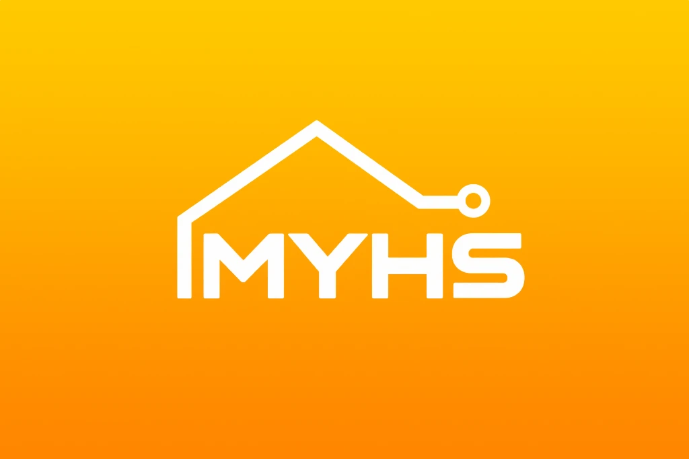
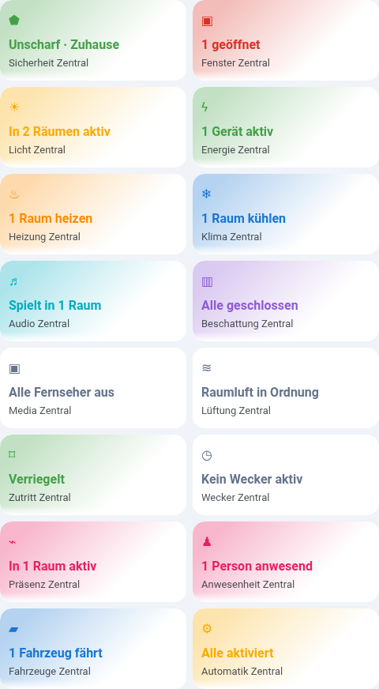
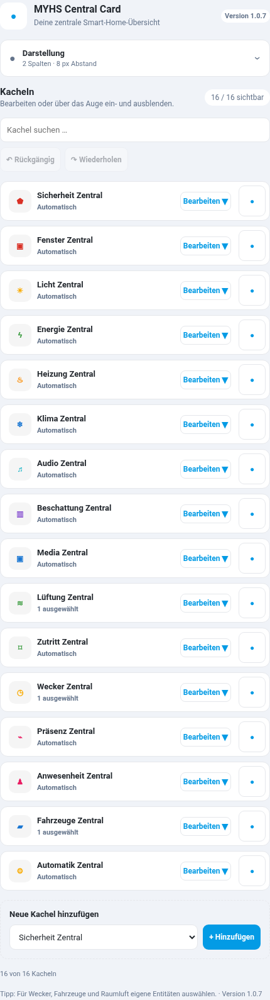
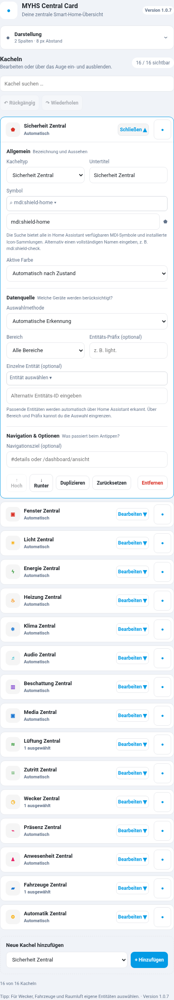

# MYHS Central Card



**MYHS Cards for Home Assistant**  
**Version 1.0.6** · 16 Status-Kacheln · Visueller Editor · Kurze Statusmeldungen

MYHS Central Card ist eine moderne Dashboard-Karte für Home Assistant. Sie fasst wichtige Informationen aus deinem Smart Home in einer flexibel konfigurierbaren Übersicht zusammen – mit klaren Statusanzeigen, farbigen Verläufen und einem integrierten visuellen Editor.



*Beispieldarstellung mit Testdaten.*

## Highlights

- **16 individuell konfigurierbare Kacheltypen** für die wichtigsten Smart-Home-Bereiche
- **Visueller Home-Assistant-Editor** – konfigurieren ohne YAML
- **Einfache Kachelverwaltung** – bearbeiten, sortieren, duplizieren und über das Auge ein- oder ausblenden
- **Flexible Datenquellen** – automatische Erkennung, gezielte Entitätsauswahl oder Gruppen/Helfer
- **Freie Icon-Auswahl** – integrierte Home-Assistant-Suche sowie manuelle Eingabe
- **Theme-kompatibles Design** – Home-Assistant-Farben, dynamische Farbverläufe und helle/dunkle Themes
- **Flexible Darstellung** – 1 bis 4 Spalten, individuell einstellbare Abstände und Navigationsziele
- **Rückgängig & Wiederholen** während der Bearbeitung

## Visueller Editor



Jede Kachel besitzt eine eigene Schaltfläche zum **Bearbeiten** sowie ein separates **Auge** zum Ein- oder Ausblenden. Ausgeblendete Kacheln bleiben im Editor verfügbar.



Über **Dashboard bearbeiten → Karte hinzufügen → MYHS Central Card** lassen sich die gewünschten Bereiche direkt im Editor konfigurieren.

## Unterstützte Kacheltypen

| Bereich | Anzeige |
| --- | --- |
| Sicherheit | Status der Alarmanlage |
| Fenster | Geöffnete Fenster |
| Licht | Aktive Beleuchtung nach Räumen |
| Energie | Eingeschaltete Steckdosen und Geräte |
| Heizung | Räume mit aktivem Heizbetrieb |
| Klima | Kühlen, Heizen und Lüften |
| Audio | Audiowiedergabe und pausierte Player |
| Beschattung | Offene, geschlossene oder teilweise geschlossene Abdeckungen |
| Medien | Aktive Fernseher und Mediengeräte |
| Raumluft | Hinweise anhand konfigurierter Sensorzustände oder Grenzwerte |
| Zutritt | Schloss- und Türverriegelungsstatus |
| Wecker | Aktive Wecker |
| Präsenz | Bewegung und Anwesenheitserkennung |
| Anwesenheit | Anwesende Personen |
| Fahrzeuge | Frei definierbare Fahrzeugzustände |
| Automationen | Aktivierte Automationen |

Die automatische Erkennung nutzt Home-Assistant-Entitätsdomänen und Geräteklassen. Abweichende Geräte lassen sich über die Entitätsauswahl oder über Gruppen und Helfer einbinden. Bei einigen Kacheltypen, etwa Fahrzeugen und Raumluft, ist die manuelle Zuordnung vorgesehen.

## Installation

### Home Assistant Marketplace / HACS

1. Dieses GitHub-Repository als benutzerdefiniertes Repository vom Typ **Dashboard** hinzufügen, falls es noch nicht im Katalog gelistet ist.
2. **MYHS Central Card** installieren.
3. Home Assistant im Browser beziehungsweise in der App neu laden.
4. Die Karte in einem Dashboard über **Karte hinzufügen** auswählen.

### Manuelle Installation

1. `dist/central-overview-card.js` nach `/config/www/central-overview-card.js` kopieren.
2. Die URL `/local/central-overview-card.js` als Dashboard-Ressource vom Typ **JavaScript-Modul** hinzufügen.
3. Home Assistant neu laden und **MYHS Central Card** hinzufügen.

## Konfiguration

Alle Funktionen sind über den visuellen Editor erreichbar. Optional ist auch eine YAML-Konfiguration möglich:

```yaml
type: custom:central-overview-card
columns: 2
gap: 8
tiles:
  - kind: windows
    label: Fenster
    source: auto
    tone: error
  - kind: lights
    label: Beleuchtung
    source: auto
    tone: warning
  - kind: people
    label: Anwesenheit
    source: auto
    tone: pink
```

Ohne eigene Kachelliste zeigt die Standardkonfiguration die 16 verfügbaren Typen. Bestehende Konfigurationen verwenden weiterhin den Kartentyp `custom:central-overview-card`.

### Datenquellen

- **Automatisch:** Passende Home-Assistant-Entitäten werden anhand von Domäne und Geräteklasse gesucht.
- **Entitäten:** Eine oder mehrere Entitäten werden direkt ausgewählt.
- **Gruppe/Helfer:** Die Daten kommen aus einer vorhandenen Gruppen- oder Helfer-Entität.

Die Darstellung und die aktiv verwendeten Farben passen sich an die Home-Assistant-Theme-Variablen an. Es werden keine benutzerdefinierten Farbvariablen benötigt.

## Statusmeldungen

Die Statusmeldungen sind bewusst kurz und einheitlich gehalten. Die Karte wertet ausschließlich in Home Assistant verfügbare Entitäten aus.

Beispiele:

| Bereich | Beispieltext |
| --- | --- |
| Sicherheit | Unscharf · Zuhause / Scharf · Abwesend |
| Fenster | Alle geschlossen / 3 geöffnet / 1 gekippt |
| Licht | Alles aus / 2 Räume aktiv |
| Energie | Keine Geräte aktiv / 6 Geräte aktiv |
| Heizung und Klima | Keine Räume aktiv / 2 Räume heizen / 1 Raum Automatik |
| Audio | Alle pausiert / Spielt in 2 Räumen |
| Beschattung | Alle oben / 2 teilweise · 1 unten |
| Media | Alle Geräte aus / 2 Räume aktiv |
| Lüftung | Luftqualität gut / 2 Räume lüften |
| Zutritt | Verriegelt / Entriegelt |
| Wecker | Kein Wecker aktiv / 2 Wecker aktiv |
| Präsenz | Keine Präsenz / Präsenz in 1 Raum |
| Anwesenheit | Alle abwesend / 4 anwesend |
| Fahrzeuge | Alle Fahrzeuge parken / 1 Fahrzeug fährt |
| Automatik | Alle inaktiv / Alle aktiv / 3 Automationen aktiv |

Bei **Audio** wird wie gewünscht „Alle pausiert“ angezeigt, wenn kein Audio-Player gerade wiedergibt.
Bei **Media** lautet der inaktive Status „Alle Geräte aus“.

Fenster unterstützen die Zustände **geschlossen**, **gekippt** und **offen**. Falls ein ausgewählter Sensor numerische Zustandswerte liefert, werden auch `1` (geschlossen), `2` (gekippt), `3` (offen) sowie `4`/`5` (geschlossen) erkannt. `0` wird ignoriert.

Bei Heizung und Klima wird, soweit vorhanden, die tatsächliche `hvac_action` statt nur des eingestellten Modus berücksichtigt.
Die Berechnung berücksichtigt nur auswertbare Entitäten; `unknown` und `unavailable` werden vollständig ignoriert.

## Hinweise

Die Kacheln dienen der **Statusanzeige und Navigation**. Geräte und Sicherheitsfunktionen werden durch Antippen nicht direkt geschaltet.

Der Alarmzustand `armed_home` wird standardmäßig als aktivierte Heimsicherung behandelt. Für bestehende Sonderkonfigurationen ist im Editor eine Kompatibilitätsoption vorhanden.

Das Verhalten einzelner Integrationen kann je nach Home-Assistant-Installation abweichen.

## Lizenz

MIT – siehe [LICENSE](LICENSE).
